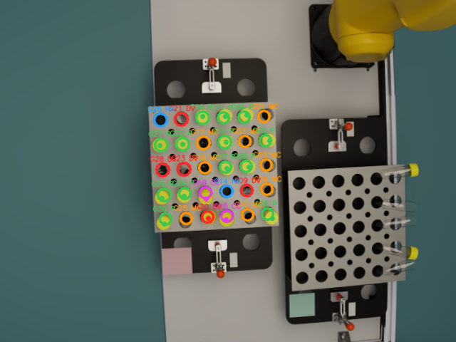
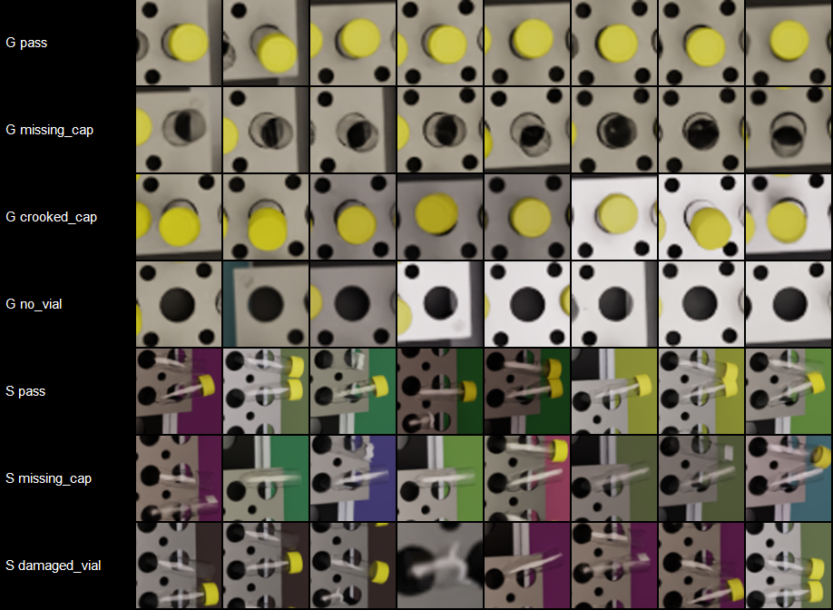
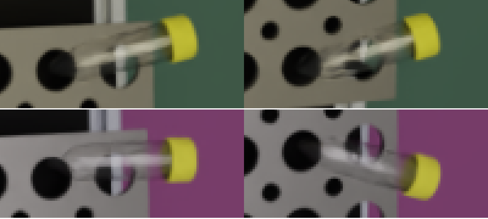

# Vial inspection from a digital twin: synthetic data and a per-position classifier

MSOE AI Club, Rockwell Automation × NVIDIA hackathon. This repo trains a classifier for the CSI vial line's
cap-seal camera **without real labeled images**. It renders labeled frames from the CSI digital twin in
NVIDIA Isaac Sim and trains a classifier that labels every tray position as one of five classes:

| Class | Meaning |
|---|---|
| `pass` | Cap and vial look acceptable |
| `missing_cap` | Vial present, open mouth |
| `crooked_cap` | Cap visibly tilted or not seated (vial lean alone is not a defect) |
| `damaged_vial` | Chipped rim or finish, broken neck, star fracture or body crack |
| `no_vial` | Empty position |

Everything ran on **YAAD**, CSI's pool of NVIDIA DGX Sparks (GB10, arm64).



## Repository layout

```
digital_twin/csi_digital_twin_v1/     the CSI twin files this work needs (tray inspection station only)
  stations/tray_inspection/*.usdc     station USD (Git LFS, 129 MB)
  cameras/CapSealCam.json             camera calibration (intrinsics, k1 lens distortion, pose)
  tools/render_example.py, apply_lens.py   CSI's render + lens tools (unchanged)
  tools/sdg_vials.py                  synthetic data generator (this project)
  tools/inspect_*.py                  scene / geometry / camera inspection used to build the generator
classifier/
  vial_crops.py                       crop code shared by training and inference
  make_crops.py                       frames + labels -> one crop per position, train/val split by frame
  train_classifier.py                 ResNet-18 fine-tuning (in-memory data, GPU augmentation)
  predict.py                          layout builder + inference on real 640x480 frames
  eval_damage.py                      per-damage-type recall analysis
yaad/                                 job scripts used on YAAD
model/                                trained model.pt, metrics.json, train_log.csv, layout.json
docs/images/                          preview sheets and analysis figures
```

## Pipeline

### 1. Synthetic data (`sdg_vials.py`, Isaac Sim 5.1, headless)

Each frame, every position of the good tray (`G01`–`G30`, upright vials) and the scrap tray (`S01`–`S05`,
vials lying down) gets a class, and the scene is edited to match. Edits go only in the USD session layer,
so the station file is never modified.

- `missing_cap` and `no_vial` hide the cap, or the cap and tube.
- `crooked_cap` tilts the cap 8–25° about a point on its rim and lifts it slightly. `pass` vials get
  0.3–2° of seating variation, and many vials get 0.5–3° of harmless lean, so that lean alone doesn't
  look like a defect.
- `damaged_vial` replaces the tube with a procedural mesh: a jagged notch in the rim (`chipped_rim`), a
  break line with the top removed and a few shards (`broken_neck`), or white crack ribbons on the side
  facing the camera (`star_fracture`, `body_crack`). Fracture surfaces use a stress-whitened material.
- Each frame randomizes light intensity and color, a dome light, the background, cap and tray materials,
  vial gloss, and camera pose (about ±3 mm and ±0.4°).
- CapSealCam renders a 768×576 pinhole image with overscan. The real lens distortion (k1) and the crop to
  640×480 are then applied exactly as in CSI's `apply_lens.py`.
- Labels are written per frame: the class plus pixel geometry, from the projection the renderer actually
  used (Replicator `camera_params`). That is the aperture center and radius for `G` positions, and the
  vial axis, diameter and box for `S` positions.

```bash
/isaac-sim/python.sh tools/sdg_vials.py --trays G,S --frames 500 --seed 11 --out out \
    --weights pass=0.4,missing_cap=0.2,crooked_cap=0.2,damaged_vial=0,no_vial=0.2   # add --preview for overlays
```

### 2. Crops (`make_crops.py`)

The classifier sees one 128×128 crop per position:

- **`G` positions:** a square around the aperture. Neighboring vials are partly in view, as in the real
  labeled crops.
- **`S` positions:** the lying vials are about 30 px apart, so these crops follow the intact vial's axis.
  They're rotated so the vial lies horizontal, at a fixed scale whatever the damage. Outside a band around
  the target vial the crop is dimmed, so it's clear which vial the label belongs to.



### 3. Training (`train_classifier.py`)

- **Model:** ImageNet-pretrained ResNet-18, AdamW with a one-cycle learning rate, bf16, 15 epochs.
- **Speed:** crops are decoded once into memory, and augmentation runs on the GPU with random settings for
  each sample. Augmentations: zoom, rotation, shift, flip, brightness, contrast, saturation, grayscale,
  lower resolution, blur and noise. This takes 44 s per epoch on a GB10. DataLoader worker processes hang
  in the YAAD containers, and decoding in-process took 17 min per epoch.
- **Loss weights per (tray, class) pair,** capped at 10×. `damaged_vial` exists only on the scrap tray.
  With per-class weights, every lying vial ended up predicted as damaged.

### 4. Inference on real frames (`predict.py`)

```bash
python classifier/predict.py layout --out layout.json RUN_DIR [RUN_DIR ...]      # nominal positions
python classifier/predict.py run --check-layout --layout model/layout.json --out check frames/   # align first
python classifier/predict.py run --model model/model.pt --layout model/layout.json --out preds frames/
```

- **Output:** for each position, the class, its confidence and all 5 class probabilities, written as
  per-frame JSON plus `predictions.csv` and overlay images. Positions below `--min-conf` are marked
  `uncertain`.
- **Alignment:** if the real camera sits slightly differently from the twin, move the whole layout with
  `--shift DX DY`, `--scale` and `--rotate`, and check the result with `--check-layout`.
- **Evaluation:** `--labels DIR` reports accuracy against hand labels.

## Results (synthetic validation set: 10,010 crops from frames never used for training)

| Scope | Accuracy | Macro-F1 |
|---|---|---|
| All | 0.985 | 0.909 |
| `G` tray | 0.9998 | 0.9998 |
| `S` tray | 0.706 | 0.797 |

| `S` `damaged_vial` by damage type | Recall |
|---|---|
| `broken_neck` | 1.00 |
| `chipped_rim` | 1.00 |
| `body_crack` | 0.00 |
| `star_fracture` | 0.00 |

**These are synthetic scores.** No real labeled frames were available yet. A `G` score of 0.9998 says the
renders are cleaner than reality, not that the model will be that good on the real line.

## Findings worth knowing

1. **Use Isaac Sim 5.1.0 on the GB10, not 6.0.0.** With 6.0.0, headless Replicator captures come back
   empty (`shape (0,)`) with both PathTracing and RaytracedLighting, even with warm-up and retries.
   5.1.0 renders the same script correctly. The CSI host confirmed this and recommends 5.1.0.
2. **Isaac Sim 5.1 clamps the camera focal length to at least 0.5.** CapSealCam authors 0.367, so it
   rendered about 1.36× zoomed in compared with the calibration (fx 888.9 px instead of 652.9 px). This
   includes the stock `render_example.py`. `sdg_vials.py` scales the focal length and both apertures by
   100, which keeps the field of view, and checks the result through `camera_params` (652.91 px).
3. **Hairline cracks are invisible at this camera's resolution.** The camera resolves about 0.7 px/mm, so
   0.2–0.6 mm cracks cover less than half a pixel. They also merge with the reflection along the top of a
   lying vial. The model gets 0% recall on them, with the same damage probability as for intact vials.
   This is a limit of the data, not the model. Whether real cracks can be detected depends on how they
   look in real frames. Shape damage (broken neck, chipped rim) is detected reliably.
   
4. **On the good tray, `damaged_vial` isn't learnable from this camera.** It looks almost straight down,
   so caps hide the rims and bodies, and a broken or chipped vial with its cap off looks like
   `missing_cap`. Damage is therefore generated on the scrap tray, where the lying vials face the camera.
5. **The twin has 5 scrap-tray positions, but the real labeled data mentions `S08`.** The real tray is
   larger or numbered differently, so a model trained on these 5 fixed spots may not transfer.

## Next steps

- **Get real frames** from the cap-seal camera: full 640×480 frames, a mix of lighting and fill levels,
  and examples of each damage type. Check them with `predict.py --check-layout` first, then measure
  real-world accuracy with `--labels`.
- **Render cracks only at sizes the camera can see,** matched to real examples, or drop them from
  training.
- **Rebuild the scrap tray** to match the real layout.

## Reproducing on YAAD

- `yaad/run_s_preview.sh`: render a preview from the team workspace.
- `yaad/prep_training.sh`: build the crops and the layout from the generator's job results.
- `yaad/train_job.sh`: the training pool job (image `python:3.12-slim`, PyTorch cu130 wheels).

Generator jobs used image `nvcr.io/nvidia/isaac-sim:5.1.0` with `ACCEPT_EULA=Y` and `PRIVACY_CONSENT=Y`,
48 GB and 8 CPUs. They render about 3–4 s per frame after a ~90 s startup.

The digital-twin files in `digital_twin/` are CSI's and are included for reproducibility.
